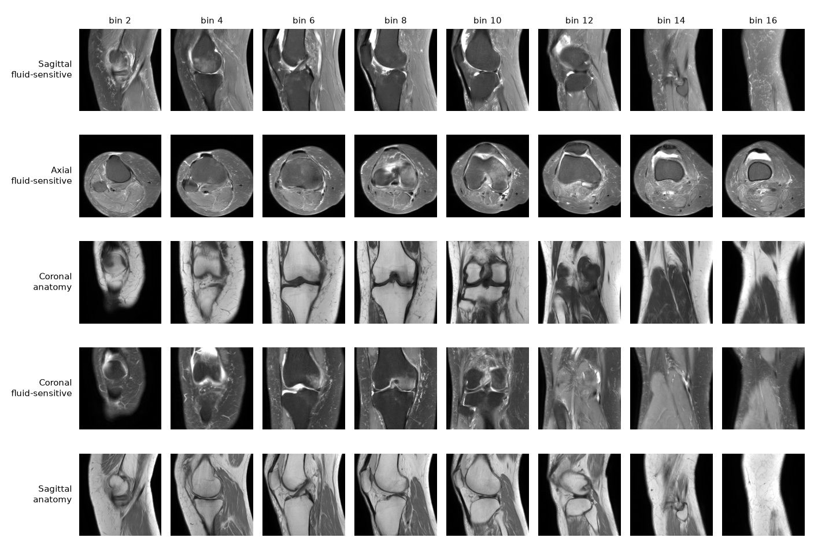
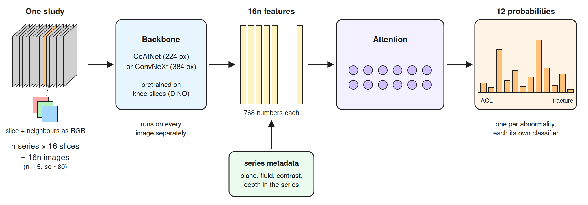

# Learning with Kaggle
2026-10-23

## The competition

The [RSNA Knee Abnormality Detection competition](https://www.kaggle.com/competitions/rsna-knee-abnormality-detection) was held on Kaggle in 2026. It's about training MRI image model that finds 12 abnormalities - binary classification.

I was interested in the efficiency track. It rewards submissions that balance accuracy and runtime - discouraging huge pipelines or large ensembles.

This was my first serious attempt at training an image model. The goal of this post is to summarize what I learned.

## Labels

Generating reliable training labels was the main challenge. The winning team reached a similar conclusion There are 4407 training studies. Expert binary golden labels were available for only 58 of them.

A free-text medical report was provided for each training study (but not during inference). The radiologist hadn't necessarily written the report with the competition in mind. The definitions of the abnormalities could differ and each hospital had its own reporting habits, such as using templates or tending to under-report certain abnormalities. So how could I turn these general reports into training labels?

I used several LLMs with different prompts to produce labels. I found that LLM-generated numerical weights aren't trustworthy, so I opted for explicit, human-readable levels that I'd later convert into soft labels:

Absent | unknown | possible | minor | severe

Six LLM passes graded each report - Qwen and Gemma running locally, plus four from [Adaption](https://adaptionlabs.ai/) - with varied prompts.

I combined the outputs with some post-processing. For example, I used effusion as a weak signal when synovitis was unknown. The result was 0.898 macro AUC on the golden set. That's competitive based on what I saw on the discussion forum.

Synovitis remained a major problem. I gave 6.1-Sol subagent access to images without report and had it determine presence. However, the gain on public was underwhelming (0.001 AUC).

Another strategy was to use out-of-fold predictions to improve labels through blending. I blended my labels with predictions on hold-out from two model families - and that got to 0.9295 AUC. For reference, the winning team's labels are 0.943. They used a more sophisticated pipeline with Astra subagent that inspected multiple images per study.

### Study preprocessing

Each study has several MRI series that differ in imaging plane and type (i.e. fluid-sensitivity). And each series has many slices - individual images.

I used a fixed crop. Images of left knees were mirrored to match orientation of right knees - so that abnormalities would appear in consistent locations. The slices were divided into 16 bins, one slice sampled from each. Each slice uses its neighbours in R and B channels. That's 2.5D - a common method for grayscale to take advantage of additional channels as pretrains typically use RGB.

Here is one study, every second bin shown:

### The model

Every image goes through a backbone and comes out as a feature vector. Attention pooling is applied for all slices and then and final classification.

I used two backbones:

- **CoAtNet** at 224 px
- **ConvNeXt-S** at 384 px

I also experimented with ConvNeXt at 224 px, ResNet and ViT.

I used DINO to adapt the backbone to 2.5D knee MRI domain. DINO is a self-supervised pretraining method. A student is shown crops and a teacher - full images. The student learns to match the output distribution of the teacher.  

The final submission averages predictions from the two models.

 

### Training

The training recipe was mostly standard. AdamW, 15-20 epochs, LR warmup followed by cosine with weight averaging (EMA). A few additions:

- **ELR** helped regularize the noisy labels towards 0/1
- **Dropout on series and slices.**
- **Compartment masking.** A part of the image is randomly masked and the loss is 0 for findings expected in that part 

ELR was originally proposed to stop memorization of noisy labels. It helped with AUC but heavily pushed probabilities towards 0. To make the usable for blending, I used σ(logit(p)/3) for p<0.5 and kept p>0. 

Compartment masking choose fixed segments that were produced by manual inspection of images for abnormalities and turned off gradients for masked abnormalities. 

I also tried to use zoomed-in compartments as the R and B channels instead of neighbouring slices as in 2.5D. That was a substantial change and I expected clear results but got flat instead. Seems like focusing on specific zooms retained AUC for some finding but lost on others.

I used two RTX 3090 GPUs for running two experiments in parallel. 

## Inference

The budget for the submission was two T4s with 2 CPU cores.

- **Image preprocessing on the GPU.** 
- **Compiled models.** Both backbones are compiled ahead of time 
- **GPU Load Balancing**
- **Fewer files.** Skip reading images that won't be necessary

I used an agent to semi-autonomously improve speed. By making it measure and show improvement, it did a great job and the scoring time is competitive, especially for the 224 px configuration.

## Results

| Submission | Public | Private | Scoring Time |
|---|---:|---:|---:|
| CoAtNet 224 + ConvNeXt 384 | 0.954 | 0.93997 | 446s |
| CoAtNet 224 + ConvNeXt 224 | 0.95 | 0.937 | 264s |

That placed me at #22 in the efficiency scoreboard. 

## Reflection

I gave Opus/Sol control over my GPUs and have them pick and run experiments. They struggled to get meaningful results. Things improved when I used them to discussion and implement handpicked experiments. Results really picked up when I hand-maintained a document of findings - what did/didn't work and overall architecture and goals.  

I could have further improved the labels. I could have kept iterating on the student labels and producing incremental blends. I could have played with the abnormality definitions more. I'm happy with the overall pipeline - it's just that minor label improvements produced substantial results.

A main issue was the modeling. The meaningfully higher result on 384 over 224 meant that higher focus helped. I measured confounding - if medial arthritis is visible, model scores lateral higher even without looking at the lateral section. The winning solution used an additional network just for cropping before feeding into the classifier. Compartment masking was simply too coarse of a method.

## Conclusion

Agents still can't autonomously do ML - though they certainly help with speed of implementation. I didn't have to write any code for this competition. Thinking and planning are my own - as well as maintaining document of findings. And I did learn a lot new concepts such as DINO, ELR, attention pooling.

The lesson was to spend more time on the labels and the image processing. All the usual levers like hyperparameters, backbone and learning schedule were mostly dead-ends and hours of wasted compute. That's a lesson I have to relearn every time. Funny enough, that's also the direction agents kept wasting time with. 
