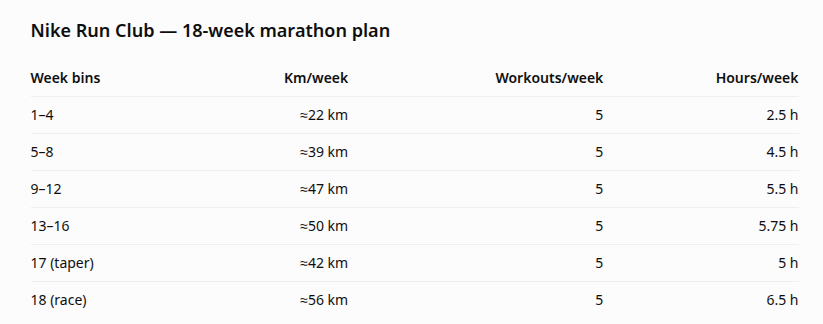
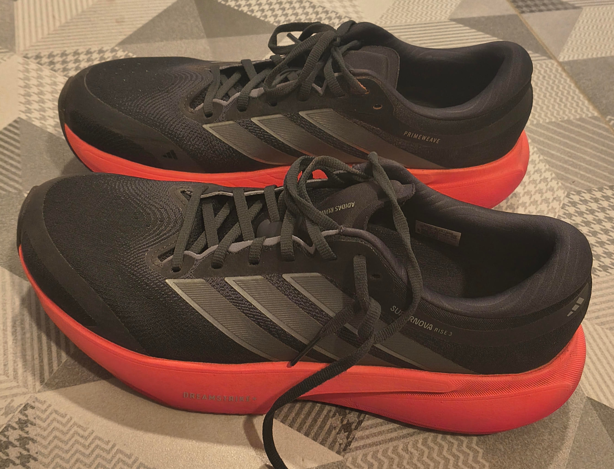
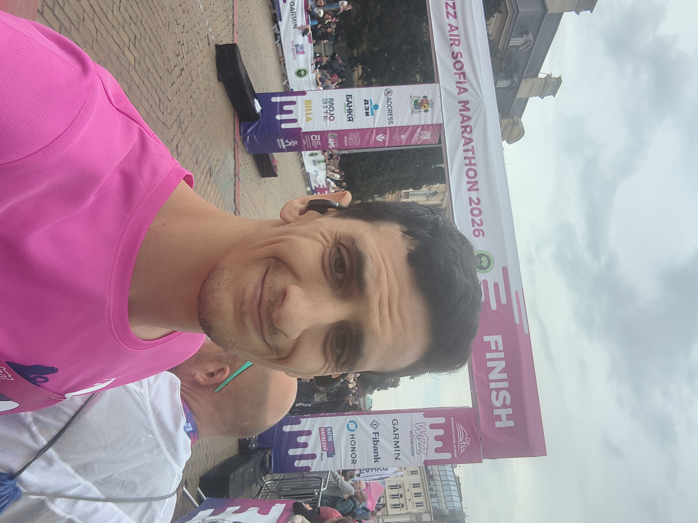

# A Marathon on Two Workouts a Week
2026-10-14

## Motivation

I have never thought of myself as particularly athletic. I do work out consistently - twice a week. I wanted to see whether that is enough to complete a marathon.  

Last year I ran a half-marathon. I enjoyed the atmosphere of race day, and I felt like I could have run a bit longer.  

I was motivated to test whether elaborate marathon preparation is truly necessary. One popular program is Nike Run Club's 18-week marathon plan.

Each workout also comes with logistical overhead - about 30 minutes in my case for travel and showering. At five workouts a week, the logistics add up.

I decided to stick to my usual workout schedule - two workouts a week, two hours per session. The goal was to complete a full marathon without walking.

## Training

I've been working out consistently twice a week. I usually go to the nearest park for some calisthenics and running. Basically push-ups, pull-ups and a 9 km run. Together, this takes about two hours of my time. My usual pace is about 5:30 min/km. 

My marathon preparation consisted of four two-hour runs. I skipped the calisthenics and ran longer instead. I did one of these longer runs each week - for the four weeks leading up to the marathon.

Each two-hour run covered about 20 km, roughly the same distance as the half-marathon I'd run the year before. That's 30 km/week for four weeks - compared with my usual 18 km. 

## Shoes

A couple of weeks before the race, my feet started developing blisters. I suspected my trusty shoes were starting to wear out, so I replaced them. It's not ideal to change shoes just before a marathon, but I couldn't ignore the blisters. I bought a pair of Adidas running shoes on sale. Unfortunately, they didn't solve the problem.

I found that adhesive bandages aren't durable enough to last 20 km of running. Someone suggested Vaseline might help, so I applied some to my feet just before the marathon. It reduced the discomfort but the blisters remained and got worse.  

## The Marathon

I ran the first half at roughly my usual training pace. I was well rested, and there were many runners around to motivate me. The atmosphere of a well-organized marathon helped, especially the kids reaching out for high fives. My pace for the first half was 5:30 min/km. In retrospect, that was way too fast. I should have slowed down.

I tried to eat a small chocolate bar every 5 km. I drank water whenever I felt thirsty.

I reached the halfway point in under two hours. From then on, it was unfamiliar territory. I had never run for over two hours at a time. 

Around the 28 km mark, I noticed I was slowing down. I never regained my earlier pace. From that point on, I was running slower and slower. Other runners kept overtaking me, probably due to their better pacing. I wasn't in pain, but I definitely wanted to stop. From that moment on, the battle was simply to keep running.    

The last 10 km were especially daunting. I felt like I was running at walking speed. My pace slowed down to 7:40 min/km. In terms of speed, that's a drop from 11 km/h to 8 km/h.

 

My final time was 4:24:44. That's an average pace of 6:16 min/km and an average speed of 9.6 km/h.

## Conclusion

Turns out I could complete a full marathon. Two workouts a week were enough to finish, even considering my poor pacing and persistent blisters. 

I concede that there might be better ways to prepare. But I completed a marathon on two runs a week, and that makes me happy.